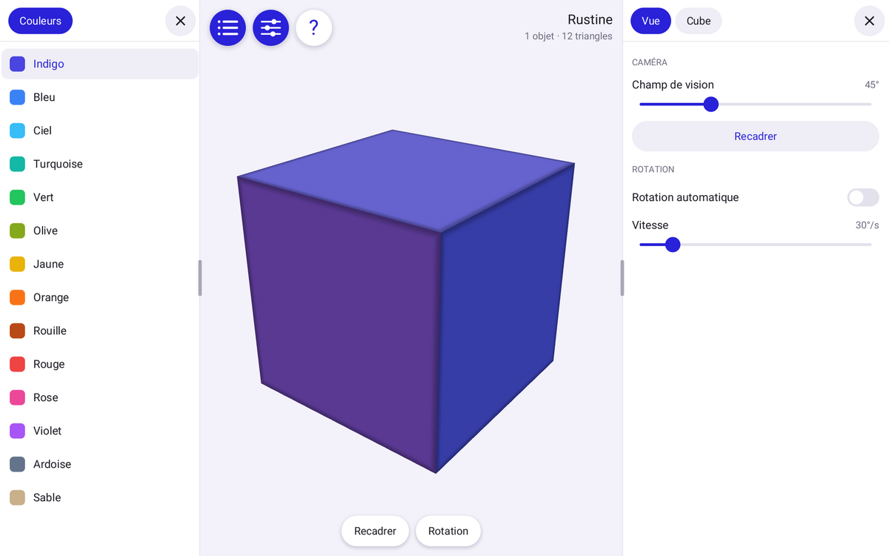

# Rustine

Socle d'applications Android en Rust : interface tactile moderne et 3D en
OpenGL ES 3, dans un APK de moins de 500 Ko.

## Télécharger

**[Télécharger l'APK (version 0.6)](https://github.com/s1pierro/Rustine/releases/download/v0.6/rustine-0.6.apk)**

Pour les appareils ARM 64 bits, sous Android 8.0 ou plus récent, avec OpenGL ES 3.
L'APK étant signé avec une clé de debug, Android demandera d'autoriser
l'installation depuis une source inconnue.

## Fonctions

- Espace de travail qui s'adapte aux panneaux, la 3D suit sa forme
- Surface de travail partagée en fenêtres, chacune avec sa vue (3D, liste,
  aide, paramètres, radio, fichiers) et une seule barre en bas : icône et titre de la vue, ligne
  d'état, poignée. Glisser la pastille + partage la fenêtre, toucher le titre
  change sa vue ou la ferme, la poignée la redimensionne et montre par un tiret
  chaque bord qu'elle peut déplacer
- Vue Paramètres : taille commune des pastilles, pilules, boutons et onglets,
  arrondi, marges (jusqu'à 0, affichage aplati), padding, taille du texte,
  hauteur des lignes, thème sombre et couleur d'accent
- Clavier virtuel dessiné par Rustine : AZERTY ou QWERTY, chiffres et symboles,
  majuscule (deux appuis pour la verrouiller), variantes à l'appui long (é, è,
  ç…), effacement répété, curseur déplacé en glissant sur l'espace, bulle
  d'aperçu, en bas de l'écran ou flottant (on le déplace en tirant son bandeau) ;
  champs de texte d'une ligne
- Réglages de l'interface et disposition des fenêtres conservés dans un fichier
  texte modifiable à la main, `Rustine/interface.txt` à la racine du stockage
  partagé, relu au retour dans l'application
- Accès à tous les fichiers demandé au lancement (par JNI) ; refusé,
  les réglages restent dans le dossier privé de l'application
- Son par AAudio et décodage par `libmediandk`, tous deux chargés à l'exécution :
  la vue Radio lit un flux web (MP3, AAC, Ogg… en HTTP ou HTTPS), avec volume, et
  garde les derniers flux écoutés dans `Rustine/radios.txt`, à côté des réglages
- Vue Fichiers : explorateur du stockage, fil d'Ariane, dossiers d'abord puis
  ordre naturel, tailles, icônes par nature, fichiers cachés à la demande ; un
  fichier audio se lit dans la piste « Fichier » du mixeur, et continue en
  arrière-plan
- Mixeur : une seule sortie AAudio où se mélangent des voies, chacune à la
  fréquence de sa source (convertie à celle de l'appareil) ; par piste, volume,
  balance, muet, solo et priorité (une piste prioritaire qui sonne baisse les
  autres) ; gains en fondu, limiteur doux, vumètres ; la vue Radio en montre le
  tableau, avec une voie d'essai générée
- Lecture en arrière-plan de tout ce que joue le mixeur, par un service Java au
  premier plan (le seul code Java de Rustine) : chaque source s'annonce (titre,
  état) à la notification et aux commandes média du système ; Pause suspend le
  mixeur sans rien perdre (un direct coupe et relance son flux), Fermer arrête
  toutes les sources ; appareil et Wi-Fi tenus éveillés pendant la lecture
- Panneaux latéraux à onglets : gauche et droite en paysage, haut et bas en
  portrait, redimensionnables au doigt
- Barre de l'application en bas de l'écran, là où le système réserve les gestes
  mais laisse les appuis : pastilles aplaties (la rustine, les panneaux), heure et
  batterie
- Bibliothèque tactile : pilules, onglets, listes défilantes, interrupteurs,
  curseurs et boutons
- Chaque doigt reste à ce qu'il a touché en premier ; hors des boutons, un doigt
  tourne la vue 3D qu'il touche, deux doigts zooment et déplacent
- Rien n'est redessiné tant que rien ne bouge

## Organisation

- `src/ui.rs`, `shell.rs`, `surface.rs`, `widgets.rs`, `clavier.rs`, `reglages.rs`, `draw.rs`, `text.rs` : l'interface, sans
  aucun appel OpenGL, donc testable partout
- `src/gles.rs`, `renderer.rs`, `android.rs`, `acces.rs` : OpenGL ES et Android
- `src/audio.rs`, `mixage.rs`, `radio.rs` : AAudio, le mixeur et la lecture de flux
  et de fichiers ; `src/explorateur.rs` : le contenu des dossiers
  (`libmediandk`) ; `java/…/Lecture.java` : le service de lecture
- `src/demo.rs` : l'application de démonstration
- `examples/apercu.rs` : dessine l'interface hors écran sur le processeur
  graphique de l'appareil et écrit des images

OpenGL, AAudio et `libmediandk` sont chargés à l'exécution avec `dlopen`. La seule dépendance Rust est
[fontdue](https://crates.io/crates/fontdue), pour le texte, dessiné à partir des
polices du système.

## Construire l'APK

Le build se fait directement sur Android, dans [Termux](https://termux.dev),
avec le Rust natif de Termux :

    pkg install rust aapt apksigner zip unzip curl git openjdk-21 d8
    bash build.sh

L'APK est produit dans `dist/rustine.apk`. La compilation a lieu dans
`~/.cache/rust-apk/rustine`, pour fonctionner aussi depuis le stockage partagé,
où rien ne peut s'exécuter.

## Tutoriel

[Construire des APK Android en Rust, sur Android, avec Termux](docs/tutoriel.md) :
de l'installation de Termux à l'APK installé, comment partir de Rustine pour sa
propre application, et la passerelle (`passerelle/`) qui permet de construire
depuis Debian, par exemple avec Claude Code.

## Licence

Rustine est réutilisable, modifiable et redistribuable à des fins non
commerciales, selon la [PolyForm Noncommercial License 1.0.0](LICENSE.md). La
mention de copyright et la licence doivent accompagner chaque copie. Pour un
usage commercial, contactez l'auteur.
